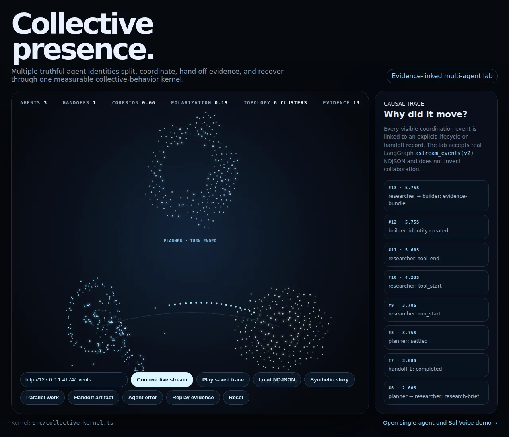
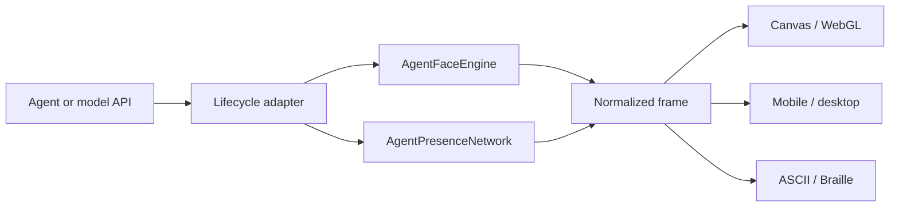

# Agent Face

> **Give any AI agent a living visual presence.**

Agent Face is a frontend-neutral engine that turns observable agent activity
into expressive particle choreography. It can render in Canvas, WebGL, SVG,
mobile, desktop, or a terminal—without claiming access to hidden reasoning or
inventing emotions.

Pi Face is the first reference adapter: a local cat companion for the
[Pi coding agent](https://pi.dev) with ASCII, Unicode Braille, ambient-status,
and particle-swarm rendering.



## Why Agent Face?

Most agent avatars focus on speech, lip sync, or simulated emotion. Agent Face
visualizes what software agents actually expose:

- Runs starting and settling
- Tools and functions beginning or ending
- Parallel and nested operations
- Waiting for user input
- Errors, cancellations, and interruptions

The result is a reusable visual language rather than a single character or
frontend.

- **Tool-aware:** execution becomes a hammer, search a lens, edits a pencil,
  parallel work a network, and unfamiliar tools a gear.
- **Renderer-independent:** particle positions and velocities are normalized
  from 0–1.
- **Truthful:** states come from observable lifecycle events.
- **Local-capable:** the engine requires no model calls, API keys, telemetry,
  servers, or network requests.
- **Organic but testable:** seeded simulations vary naturally while remaining
  deterministic when supplied the same seed.
- **Locally emergent:** particles separate, align, cohere, and follow seeded
  flow fields rather than merely interpolating between assigned coordinates.
- **Concurrency-aware:** tool-call IDs preserve parallel and nested activity.

## Choose a starting point

| Goal | Start here |
| --- | --- |
| Explore the graphical concept | [Run the Canvas demo](#canvas-reference-demo) |
| Visualize real multi-agent events | [Use the Collective Presence Lab](#collective-presence-lab) |
| Add a face to another agent | [Embed the presence engine](#embed-the-presence-engine) |
| Connect a model or agent API | [Build an API adapter](#build-an-api-adapter) |
| Use the terminal companion | [Install the Pi adapter](#install-the-pi-adapter) |
| Understand its claims | [Truthful state semantics](#truthful-state-semantics) |

## Architecture



The layers are intentionally separate:

1. **Event adapter:** translates host-specific callbacks or stream events.
2. **Presence engine:** tracks truthful state, concurrent tools, and visual
   choreography. `AgentPresenceNetwork` coordinates multiple named engines and
   explicit artifact handoffs.
3. **Normalized frame:** exposes mood, motif, and particles independent of a UI.
4. **Renderer:** decides how the same frame looks on a particular frontend.

## Canvas reference demo

The browser demo imports the same `AgentFaceEngine` used by the Pi adapter. It
can replay a complete tool story or preview each choreography individually.

```bash
npm ci --ignore-scripts
npm run demo:build
npm run demo:serve
```

Open [http://localhost:4173](http://localhost:4173).

Available previews include:

- An emergent human-like face formed entirely from the swarm
- Observable output pulses that animate the mouth region
- Persistent core particles that collapse into a signature constellation during transformations
- Hammer for shell or execution tools
- Lens for reading and search
- Pencil for editing and writing
- Network for parallel or batched work
- Gear for unfamiliar operations
- Waiting, completion, interruption, and error states

The demo supports `prefers-reduced-motion` and uses normalized positions rather
than terminal coordinates. Give it a stable identity seed through the URL:

```text
http://localhost:4173/?identity=agent-face:pi:ryan:primary:v1
```

Reloading that URL reproduces the same movement signature. Use **Speak** to
preview output-driven mouth motion and **Cat form** to compare the original Pi
identity. Add a session value for stable identity with per-session variation:

```text
http://localhost:4173/?identity=agent-face:pi:ryan:primary:v1&session=2
```

### Sal Voice adapter

The **Speak with Sal** control connects Emergent Face to the five canonical,
alignment-locked Sal Voice member recordings from checkpoint 39,500. Web Audio
measures the real mixed waveform and dispatches bounded `output` intensity, so
the mouth resolves and moves from observed sound rather than a scripted timer.

```ts
const intensity = salVoice.intensity();
if (intensity > 0.025) {
  face.dispatch({
    type: "output",
    intensity,
    members: salVoice.memberIntensities(),
  });
}
```

The presence engine remains network-free. This optional demo adapter fetches
the public member recordings from the Sal Ensemble Lab only after the user
clicks **Speak with Sal**. A production adapter can apply the same analyser to
live synthesis, streamed audio, or any other voice provider.

### Collective Presence Lab

Open [http://localhost:4173/collective.html](http://localhost:4173/collective.html)
to see multiple named identities, explicit artifact handoffs, per-agent errors,
collective-order metrics, and an evidence tape answering “Why did it move?”

The lab includes a first-party adapter for LangGraph `astream_events(v2)`. It
maps observable node, tool, output, and custom handoff records without reading
or claiming hidden reasoning. Load a saved `.ndjson`/`.jsonl` trace, or run the
local chunked-stream harness in another terminal:

```bash
npm run demo:stream
# then click “Connect live stream” in the Collective Presence Lab
```

The default live endpoint is `http://127.0.0.1:4174/events`; its health check is
`http://127.0.0.1:4174/health`. Replace the URL with a compatible LangGraph
NDJSON endpoint for an actual application.

Explicit handoffs use a LangGraph custom event named `agent_handoff` with
`from`, `to`, `handoff_id`, `artifact_id`, and `status`. The visual bridge exists
only while those recorded events justify it.

## Embed the presence engine

`AgentFaceEngine` is the frontend-neutral API.

```ts
import { AgentFaceEngine } from "./src/presence.ts";

const face = new AgentFaceEngine(1234, "idle", "emergent-face");

face.dispatch({ type: "run_start" });
face.dispatch({
  type: "tool_start",
  id: "call-1",
  name: "search",
});

const frame = face.advance();
```

The seed is optional. Supply a stable seed when the same agent should preserve
its movement personality across reloads.

### Lifecycle events

| Event | Meaning |
| --- | --- |
| `{ type: "run_prepare" }` | The host is preparing a new request |
| `{ type: "run_start" }` | A low-level agent run began |
| `{ type: "run_end" }` | That run ended while retries or queued continuation may remain |
| `{ type: "finalizing" }` | The host is checking whether work can settle |
| `{ type: "tool_start", id, name, parentId? }` | A named tool or nested function began |
| `{ type: "tool_update", id, progress? }` | An observed partial tool update arrived |
| `{ type: "tool_end", id, isError }` | That operation finished |
| `{ type: "prompt_start", kind? }` | The UI is blocking for input, selection, or approval |
| `{ type: "prompt_end" }` | The blocking prompt closed |
| `{ type: "message_end", stopReason }` | An assistant message ended, errored, or aborted |
| `{ type: "settled", aborted? }` | Automatic retries and queued work have stopped |
| `{ type: "model_selected", name }` | The host selected a model |
| `{ type: "manual", mood }` | Preview a cosmetic mood |
| `{ type: "output", intensity? }` | Pulse the face from observed streamed text output |
| `{ type: "form", form }` | Select `cat` or `emergent-face` as the home form |
| `{ type: "idle" }` | Move a completed run back to idle |
| `{ type: "reset", mood? }` | Reset the engine for a new session |

Tool IDs matter. Preserve the host's IDs so multiple simultaneous or nested
operations remain active until each corresponding `tool_end` arrives. Pass
`parentId` for nested calls and normalized `progress` from 0–1 when the host
provides trustworthy progress metadata. Multiple active tools select the network
motif instead of pretending that one tool represents the whole batch.

### Closed tool-expression algebra

Tool activity is preserved as a closed expression rather than only collapsed to
one icon:

```text
ToolExpr :=
  Identity
  | Atom(tool id, name, motif, status, progress)
  | Sequence(ToolExpr...)
  | Parallel(ToolExpr...)
  | Nested(parent, children)
  | Failed(ToolExpr)
```

Every constructor returns another `ToolExpr`. `Sequence` is associative,
`Parallel` is associative and commutative, `Identity` is neutral for both, and
`Failed` is idempotent. Runtime intervals determine whether sibling calls were
sequential or overlapping; `parentToolCallId` preserves nesting. The event tape therefore distinguishes
`read ; edit`, `read ∥ edit`, and `codemode ▷ read`.

A deterministic visual homomorphism projects the expression into normalized
layers and links:

- Sequence lays motifs left-to-right with directed links.
- Parallel lays motifs in simultaneous cells around a shared hub with sparse dotted links.
- Nesting places child motifs inside the parent's field with a sparse parent-child link.
- Failure perturbs the failed layer without erasing the rest of the expression.
- Progress reveals a bounded fraction of the active motif; completed history
  remains as a lighter structural trace.
- Compact titles name the operator explicitly, for example
  `[parallel: hammer ∥ lens]`, so small terminals do not rely on shape alone.

The normalized frame exposes the structured expression, canonical key, readable
expression, visual plan, and active motif list. This is deterministic software:
no model is asked to infer tool composition.

### Normalized frame output

```ts
interface AgentFaceFrame {
  mood: Mood;
  phase: "starting" | "running" | "continuing" | "streaming" | "tool" | "waiting" | "finalizing" | ...;
  label: string;
  tick: number;
  runCount: number;
  activeToolName?: string;
  activeToolCount: number;
  nestedToolCount: number;
  toolProgress?: number;
  modelName?: string;
  toolExpression: ToolExpression;
  toolExpressionKey: string;
  toolExpressionText: string;
  toolSummary: string; // complete compact motif expression
  toolVisualPlan: ToolVisualPlan;
  activeMotifs: readonly ToolMotif[];
  motifs: readonly ToolMotif[];
  toolOperator: ToolExpression["kind"];
  motif: "hammer" | "lens" | "pencil" | "network" | "gear";
  motifVisible: boolean;
  motifEcho: boolean;
  homeForm: "cat" | "emergent-face";
  outputActive: boolean;
  particles: readonly {
    x: number;   // 0–1
    y: number;   // 0–1
    vx: number;  // normalized velocity
    vy: number;
    role: number;
    core: boolean;
    member: number; // persistent Sal channel, 0–4
  }[];
}
```

A renderer can map these values into any viewport:

```ts
const x = paddingX + particle.x * drawableWidth;
const y = paddingY + particle.y * drawableHeight;
```

Terminal adapters can call `advance()` on their slower visual clock. Graphical
frontends should call `advanceTime(elapsedMilliseconds)`, which runs bounded
fixed-step 60 Hz physics while preserving the shared animation timeline.

### Collective behavior kernel

Particles are governed by a deterministic local-motion kernel:

- Separation prevents collapse and creates pressure along contours.
- Alignment transfers direction through neighboring particles.
- Cohesion keeps local groups intact without forcing one global blob.
- A seeded curl field creates persistent currents and vortices.
- Semantic fields weakly attract particles toward faces and tool motifs.
- Persistent member IDs route five independent Sal amplitude channels into five
  overlapping acoustic currents.

The semantic field supplies meaning, but neighbor behavior supplies life. Tool
and face shapes therefore assemble, erode, and repair themselves instead of
moving every particle to a permanently assigned coordinate.

### Emergent Face mode

`emergent-face` is not a rigid facial sprite. At rest it is an abstract living
cloud maintained by neighbor forces and flow. Observed output or a blocking
user prompt draws that cloud into a face
through contours, particle density, and negative space. During tool use,
forty-four luminous core particles collapse into a recognizable signature
constellation while the rest transform into action motifs. Dispatch `output`
only when the host observes actual streamed output; repeated pulses open and
reshape the mouth without claiming that unobserved thought is speech.

## Build an API adapter

Any API can drive Agent Face if it exposes lifecycle events—or if its calls can
be wrapped to create them.

### Server-side agent

Send compact events to the frontend over WebSocket or Server-Sent Events:

```ts
socket.addEventListener("message", (message) => {
  face.dispatch(JSON.parse(message.data));
});

let previous = performance.now();
requestAnimationFrame(function draw(now) {
  render(face.advanceTime(now - previous));
  previous = now;
  requestAnimationFrame(draw);
});
```

### Generic tool wrapper

```ts
async function visibleTool(id: string, name: string, operation: () => Promise<unknown>) {
  emit({ type: "tool_start", id, name });
  let isError = false;
  try {
    return await operation();
  } catch (error) {
    isError = true;
    throw error;
  } finally {
    emit({ type: "tool_end", id, isError });
  }
}
```

### Adapter opportunities

| Host | Integration point |
| --- | --- |
| OpenAI Responses or Agents | Response/output deltas and function-call lifecycle events |
| Anthropic | Message deltas and `tool_use` content blocks |
| MCP | Tool execution start/end notifications |
| LangGraph | Included `astream_events(v2)` NDJSON and live-stream adapter |
| Custom REST | Request wrapper plus local function instrumentation |
| WebSocket agent | Dispatch lifecycle messages directly in the client |

For LangGraph:

```ts
const adapter = new LangGraphPresenceAdapter();
await consumeLangGraphNdjsonStream(response.body!, (record) => {
  for (const event of adapter.ingest(record)) network.dispatch(event);
});
```

A black-box request/response API can still show run start, completion,
cancellation, and errors. Tool-sensitive choreography requires function-call
metadata or wrappers around those operations.

## Visual grammar

Agent Face uses a three-part action grammar:

1. **Anticipation:** particles loosen from the home form and begin gathering.
2. **Action:** the swarm assembles and animates a recognizable motif while core
   particles preserve a trace of identity.
3. **Resolution:** success releases gently; errors or interruptions scatter more
   sharply before the face reforms.

Tool motifs are intentionally imperfect. Builders form the primary silhouette,
scouts orbit it, and stragglers arrive late. Fast calls leave a short visual echo
so users can still perceive what happened.

| Tool pattern | Default motif |
| --- | --- |
| Shell, execution, terminal commands | Hammer |
| Read, search, inspect, fetch | Lens |
| Edit, write, patch, format | Pencil |
| Parallel, batch, dispatch, codemode | Network |
| Unknown tools | Gear |

These mappings are a starting grammar, not a claim about a tool's intent.

## Install the Pi adapter

### Try without installing

From this repository:

```bash
pi --no-extensions -e ./extensions/face.ts
```

This isolates Pi Face from other extensions for that invocation. Do not load a
second `face.ts` at the same time.

### Install locally

```bash
pi install /absolute/path/to/pi-face
```

Pi records the package in personal configuration. Local installations reference
the directory rather than copying it, so keep the checkout in place. Add
`--local` for a project-only installation.

When migrating from a loose `~/.pi/agent/extensions/face.ts`, move that file out
of the extensions directory before installing the package. Run `/reload` or
restart Pi afterward.

```bash
pi remove /absolute/path/to/pi-face
```

### Pi commands

| Command | Effect |
| --- | --- |
| `/face` or `/face status` | Show enabled state, mood, style, and motion mode |
| `/face help` | Show the concise preset and control guide |
| `/face compact` | Use the quiet two-line Braille activity rail |
| `/face character` | Use the animated Braille portrait |
| `/face showcase` | Use the living Braille particle swarm |
| `/face on` / `/face off` | Show or hide the widget |
| `/face ascii` | Use portable five-line ASCII art |
| `/face braille` | Use an elegant 48×32-dot Unicode Braille portrait |
| `/face ambient` | Use the quiet two-line Braille status rail without a character |
| `/face ambient braille` | Explicitly select the default all-Braille ambient vocabulary |
| `/face ambient ascii` | Use the ambient rail with an ASCII-only glyph fallback |
| `/face ambient unicode` | Use mixed geometric Unicode glyphs instead of all-Braille |
| `/face style ascii\|braille\|ambient` | Select a rendering style explicitly |
| `/face motion pose` | Use normal animated poses |
| `/face motion swarm` | Use the living Braille particle swarm |
| `/face motion still` | Freeze the current rendering |
| `/face preview idle\|thinking\|tool\|happy\|error\|sleep\|waiting\|cancelled` | Preview a cosmetic mood explicitly |
| `/face idle`, `thinking`, `tool`, `happy`, `error`, `sleep`, `waiting`, `cancelled` | Backward-compatible preview shortcuts |

Manual previews are cosmetic. Real activity restores automatic state. Display
preferences are recorded in the Pi session, so they survive reloads and resumed
sessions. A genuinely new session starts with the portable ASCII pose.

Ambient mode is designed for peripheral awareness rather than personality. It
renders one adaptive Braille rail plus one textual label: streaming becomes a
traveling wave, waiting becomes a beacon, finalization converges inward, and
the closed tool algebra becomes linked Braille nodes for sequence, parallelism,
and nesting. It uses no character, border, or inferred emotion. Mixed-Unicode
and ASCII-only glyph modes are also available; the ASCII mode and
`still` motion mode provide accessibility and reduced-motion fallbacks.

The Pi adapter distinguishes request preparation, low-level runs, continuation
checks, streamed text output, tool progress, nested and parallel tools, blocking
approval/input prompts, finalization, settlement, interruption, and model
selection. It intentionally ignores `thinking_delta` content: only visible text
output drives speech/output pulses. Pi does not expose a provider-neutral reason
for every retry or backoff, so repeated runs are labeled **continuing run** rather
than guessed to be a rate limit or recovery.

Braille uses each Unicode character as a 2×4 pixel cell. The 48×32-dot portrait
uses smooth curve rasterization for the ears, eyes, muzzle, whiskers, and chest.
Use `/face ascii` if the terminal font displays blank, boxed, or misaligned glyphs.

There is no terminal widget in JSON, print, or RPC mode. When a portrait or
swarm would exceed the available terminal width, the adapter automatically
uses the compact rail rather than showing clipped art. The display uses the
active Pi theme and cleans up timers and widgets on disable, reload, session
replacement, and shutdown.

## Truthful state semantics

Agent Face visualizes evidence supplied by the host, not a model's private
mental state.

- **Idle:** no current activity.
- **Starting run:** the host entered request preparation.
- **Thinking / continuing run:** one or more low-level agent runs are active.
  This does not claim to observe hidden reasoning or identify why continuation
  occurred.
- **Streaming output:** visible assistant text deltas were observed. Hidden
  thinking deltas do not trigger this state.
- **Using tools:** at least one observed tool execution is active. Counts,
  nesting, and trustworthy progress metadata are preserved.
- **Waiting for approval/input/selection:** the host opened a typed blocking UI
  prompt. This cannot detect every approval flow or a question written only in
  prose.
- **Finalizing:** Pi reached its pre-settlement boundary and is checking whether
  another continuation is required.
- **Turn ended:** the run settled without an observed error or cancellation.
  This is not proof that the task succeeded or tests passed.
- **Error observed:** a tool or assistant message reported an error. The state
  remains visible through settlement even if the agent recovered.
- **Interrupted:** an assistant message reported an aborted operation.
- **Sleeping:** a cosmetic manual preview only.

This constraint is part of the product: personality comes from movement style,
not unsupported claims about emotion or consciousness.

## Accessibility and performance

Frontend adapters should provide:

- Reduced-motion behavior
- A still or disabled mode
- Textual state labels independent of animation
- Sufficient contrast and theme adaptation
- No reliance on color alone
- Bounded particle counts and fixed simulation steps

Terminal Braille can be noisy for screen readers or physical Braille displays,
so it is opt-in and has an ASCII fallback.

## Status

Version 0.1.0 is packaged locally and has not been published to npm. The npm
name `pi-face` is provisional and its availability has not been verified.

The Pi adapter was tested against Pi 0.99.1 with Node.js 23.11.0. Pi requires
Node.js 22.19 or newer. Other Pi versions have not been tested.

The frontend-neutral API is experimental. Event names and frame fields may
change before a first SDK release.

## Development

```bash
npm ci --ignore-scripts
npm run check
```

`npm run check` type-checks the project, builds the browser demo, and runs the
unit and adapter tests.

```text
extensions/face.ts       Pi lifecycle and terminal UI adapter
src/presence.ts          Frontend-neutral event and normalized-frame API
src/tool-algebra.ts      Closed algebra and expression-to-visual homomorphism
src/tool-motifs.ts       Total arbitrary-tool to finite-motif quotient
src/collective-kernel.ts Formal fields and collective-order measurements
src/collective-presence.ts Multi-agent identities, handoffs, evidence, replay
src/langgraph-adapter.ts LangGraph v2 NDJSON and streaming adapter
src/face.ts              Host-independent state and ASCII rendering
src/braille.ts           Braille pixel-art renderer
src/ambient.ts           Compact character-free ambient status rail
src/swarm.ts             Neighbor kernel, semantic fields, and swarm primitives
demo/index.html          Canvas reference frontend
demo/app.ts              Canvas adapter using the shared engine
demo/sal-voice.ts        Sal Voice Web Audio and amplitude adapter
demo/collective.html     Evidence-linked multi-agent laboratory
demo/collective.ts       Collective renderer and trace controls
demo/langgraph-example.ndjson Observable LangGraph event fixture
docs/canvas-demo.webp    README preview image
scripts/build-demo.mjs   Browser bundle build
scripts/langgraph-stream-demo.mjs Chunked NDJSON stream harness
test/*.test.ts           Unit and adapter tests
```

Pi supplies its peer dependencies at runtime; do not bundle separate copies.
The development dependencies provide types, tests, and the demo build locally.

### Package review

```bash
npm pack --dry-run
npm pack
```

The resulting archive contains the extension, engine, renderers, demo,
documentation, package metadata, and MIT license—not personal Pi configuration
or conversations.

## Roadmap

Potential next steps:

- Published, versioned frontend SDK
- First-party OpenAI, Anthropic, MCP, and AG-UI adapters
- Production validation against a live LangGraph deployment
- Legibility and temporal-semantics evaluation on complex real Pi tool traces
- Cryptographic artifact provenance for handoff evidence
- A versioned declarative event-to-field grammar
- React Canvas and WebGL packages
- State-recognition and calibrated-trust user studies
- Additional accessibility testing and renderer fallbacks

## Security and privacy

Extensions execute with the user's operating-system permissions. Review package
source before installation. The core Agent Face engine makes no network requests and stores no conversations
or credentials. Optional demos fetch Sal Voice assets or user-selected event
streams only after an explicit browser action.

Host adapters decide which lifecycle metadata to pass into the engine. Avoid
including prompts, tool arguments, results, secrets, or personal data when only
event type, tool name, ID, and outcome are needed.

## License

MIT
